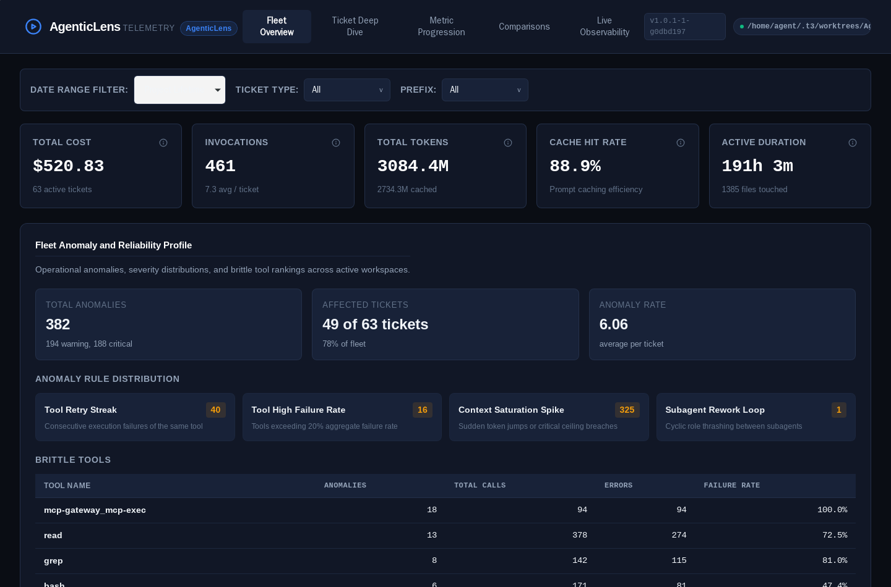
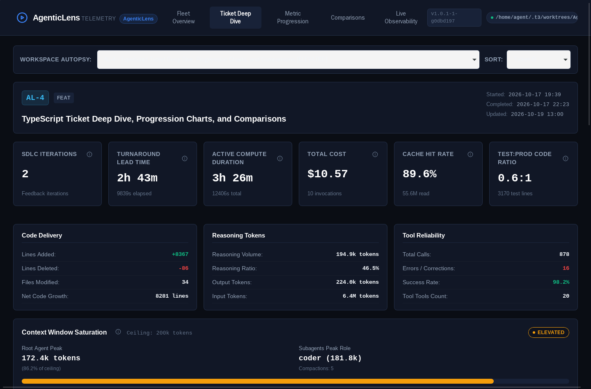
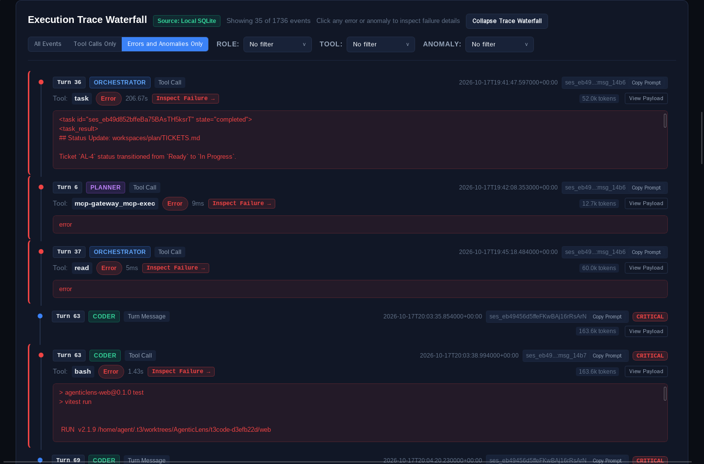
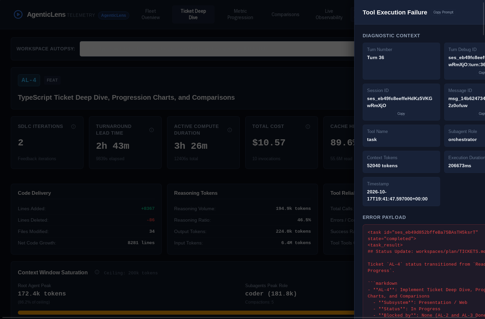
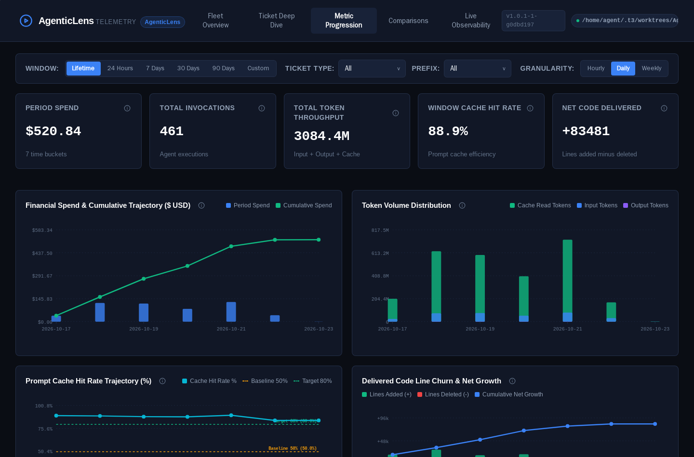
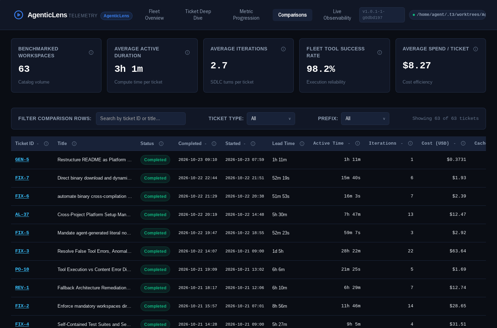

# AgenticLens

AgenticLens records multi-agent development telemetry, detects execution anomalies, and provides a local dashboard. It supports live OpenCode monitoring and offline OpenCode/Codex session ledgers. The native `agentic-lens` manager installs and selects project engines; `agentic-lens-engine` performs telemetry work and embeds the dashboard.

Ledgers are trusted, durable project records designed to be committed and shared through Git across developers, machines and harnesses. Local source sessions take precedence when refreshed; unavailable sessions remain preserved in the ledger, and the runtime aggregates the full result. Migration is best-effort and resumable across machines. See the [portable ledger contract](TECHNICAL_GUIDELINES.md#portable-ledger-contract) for preservation, refresh and compatibility guarantees.

Explore the [AgenticLens project presentation](https://niltonduarte.github.io/AgenticLens/) for the workflow, practical investigation examples and architecture.

## Install AgenticLens with Your Coding Agent

Ask your coding agent to install and configure AgenticLens in the repository. For an OpenCode agent, use this prompt:

```text
For an existing repository, use its approved shared agenticlens.version pin as <RELEASE_TAG>; otherwise resolve the latest stable AgenticLens release at https://api.github.com/repos/NiltonDuarte/AgenticLens/releases/latest and use its tag_name as <RELEASE_TAG>. Read https://raw.githubusercontent.com/NiltonDuarte/AgenticLens/<RELEASE_TAG>/.agents/skills/agentic-lens-setup/SKILL.md and follow it to install and configure AgenticLens in this repository. Use that tag for the setup bundle and exact engine pin. Review the manager version separately; its own update does not change project engine pins. Replace main or latest download references in older manifests. If a required file is absent, report it instead of falling back to main. Explain the proposed changes and ask before modifying agent policy files.
```

The `main` branch contains development for future releases. Fresh installations without an approved pin default to the [latest stable release](https://github.com/NiltonDuarte/AgenticLens/releases/latest). Repairs honor the existing shared pin; upgrades require explicit approval. Retrieve every installation file from the selected exact tag, including when a prerelease pin was explicitly approved.

The setup skill guides the agent through downloading the platform binaries, configuring the repository, and installing the skills available in that release. For releases containing the complete setup bundle, explicit setup provisions shared cached platform binaries using the local setup scripts; configured Codex worktrees adopt through the user-level native hook without per-worktree installation; if the scripts are also absent, follow the complete bootstrap in the setup manifest. Git tracking and ignore choices for all installed files belong to the repository owner. Review the [Platform Setup Manual](docs/SETUP_MANUAL.md) for the complete setup process and manual installation options.

---

## Capabilities

- **Live observability:** OpenCode SQLite polling and SSE streams show turns, tools, token growth, and subagent handoffs.
- **Anomaly detection:** Configurable rules flag tool retry streaks, high failure rates, context saturation, and subagent rework. See [rules and thresholds](ARCHITECTURE.md#31-detection-rules).
- **SDLC analytics:** Compare role effort, duration, model costs, cache efficiency, reasoning tokens, code changes, test-to-production ratios, and tool self-correction.
- **Session ledgers:** Generate versioned JSON facts and Markdown summaries from OpenCode or Codex; backfill historical facts and migrate schemas with invariant checks.
- **Standalone deployment:** Go embeds the TypeScript/React dashboard; production needs no Node.js, Docker, or external database server.

Telemetry supports planning, implementation, test review, and handoff. Ratios and anomaly verdicts inform review; they do not establish test coverage or quality.

## Visual Platform Showcase

The following captures demonstrate AgenticLens operating against real multi-agent engineering traces from 63 completed software development workspaces in this repository:

### 1. Fleet Overview & Anomaly Reliability Profile
Macro-level operational telemetry aggregating $520+ in model inference, 3.08B tokens, prompt cache efficiency, active anomaly rule distributions, and brittle tool rankings:



### 2. Ticket Forensic Autopsy & Context Saturation
Granular single-ticket autopsy (AL-4) measuring turnaround lead time versus active compute duration, test-to-production ratio, reasoning token volume, and context window saturation:



### 3. Chronological Multi-Agent Trace Waterfall
Interactive execution waterfall tracking turn-by-turn transitions between Orchestrator, Planner, Coder, and Tester roles, with sub-second execution timings and failure markers:



### 4. Deterministic Anomaly Inspector
Contextual diagnostic drawer isolating tool execution failures, parameter payloads, subagent context, and error diagnostics:



### 5. Longitudinal Metric Progression
Temporal velocity tracking cumulative financial spend trajectories, token volume distributions, prompt cache hit rate baselines, and net code churn:



### 6. Cross-Ticket Benchmarking
Comparative matrix ranking tickets by active duration, turnaround lead time, iteration cycles, and cost:



---

## CLI Overview

AgenticLens provides a unified CLI for automation and local workflows. Installed releases use the user-level `agentic-lens` entrypoint and the project's exact YAML pin. For a source checkout, `make verify-build` checks the newly built host native and `make server` launches it directly without installing or selecting a cached release:

```bash
# Start the web server and dashboard (default port: 8085)
agentic-lens server --port 8085

# Ingest active session telemetry and generate summary markdown block
agentic-lens generate --ticket-id AL-15 --ticket-type feat --json-output alspaces/AL-15/agentic_metrics.json --append alspaces/AL-15/SUMMARY.md

# Replace ses_abc123 with the Codex root session ID; child threads are discovered from it
agentic-lens generate --source codex --session-id ses_abc123 --code-ref HEAD --ticket-id AL-56 --ticket-title "Codex metrics research" --ticket-type chore --json-output alspaces/AL-56/agentic_metrics.json --append alspaces/AL-56/SUMMARY.md

# List all tracked workspaces with detected anomaly counts
agentic-lens --list

# Inspect detailed anomaly diagnostics for a specific ticket
agentic-lens --ticket-id AL-15 --anomalies

# Batch reconcile git facts and database telemetry across historical workspaces
agentic-lens backfill --source opencode --recompute-git --code-ref HEAD --recompute-db --migrate-schema --update-summaries

# Run stepwise schema migrations across workspace ledgers
agentic-lens migrate --backup --update-summaries
```

For source selection, exact session identity, committed Git refs, and session ownership semantics, see [telemetry source and session selection](docs/SETUP_MANUAL.md#telemetry-source-and-session-selection). For older ledgers, follow [unscoped tool recovery](docs/SETUP_MANUAL.md#recovering-unscoped-tool-totals). Configure file classification using the [code metrics reference](docs/SETUP_MANUAL.md#code-classification-and-interpretation).

For cost availability, partial subtotals, and explicit legacy migration, see [reported cost semantics](docs/COST_SEMANTICS.md).

## Deep Dive Documentation

- **[ARCHITECTURE.md](ARCHITECTURE.md)**: Comprehensive deep dive into the Functional Core, Imperative Shell (FCIS) pattern, domain models, adapter layers, anomaly rule engine, and schema migration mechanics.
- **[CONTRIBUTING.md](CONTRIBUTING.md)**: Developer setup, local development with hot reload, testing guidelines, complete Makefile target reference, and release packaging.
- **[TECHNICAL_GUIDELINES.md](TECHNICAL_GUIDELINES.md)**: Coding standards, typing rules (zero `any`), data race prevention, and invariant enforcement.
- **[docs/SETUP_MANUAL.md](docs/SETUP_MANUAL.md)**: Complete guide for integrating AgenticLens into target repositories via autonomous agent skills or direct binary deployment.

---

## License

This project is licensed under the MIT License. See [LICENSE](LICENSE) for details.
