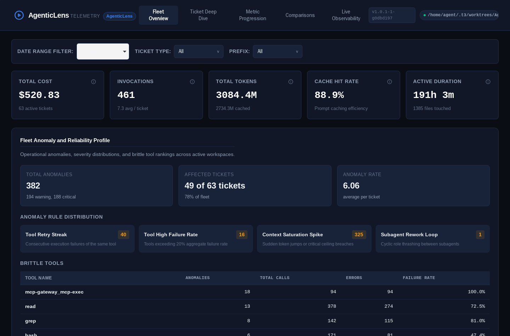
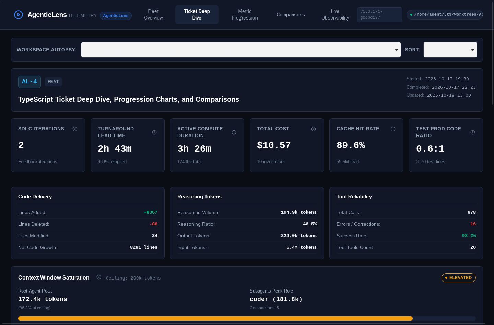
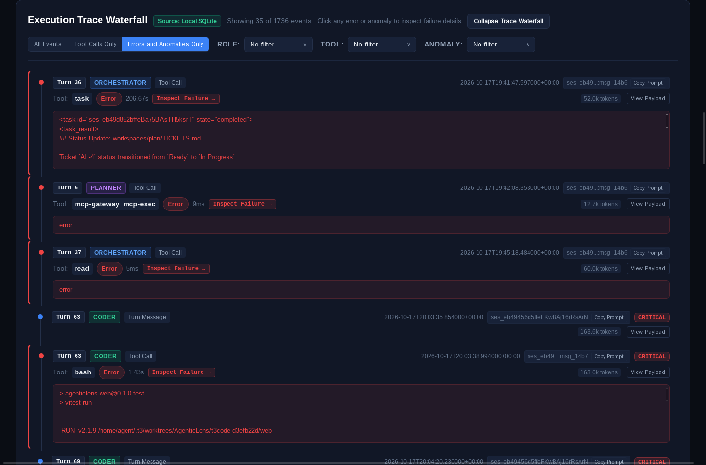
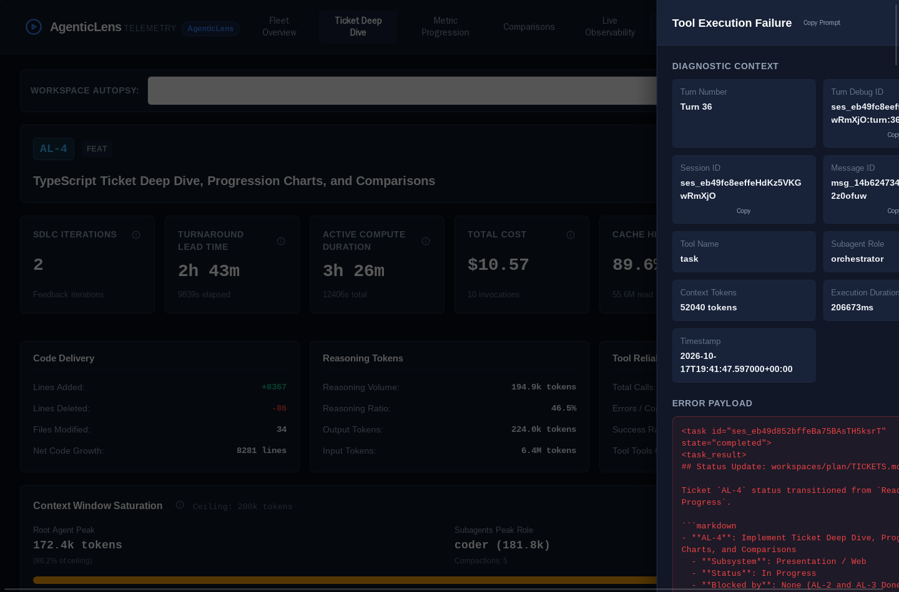
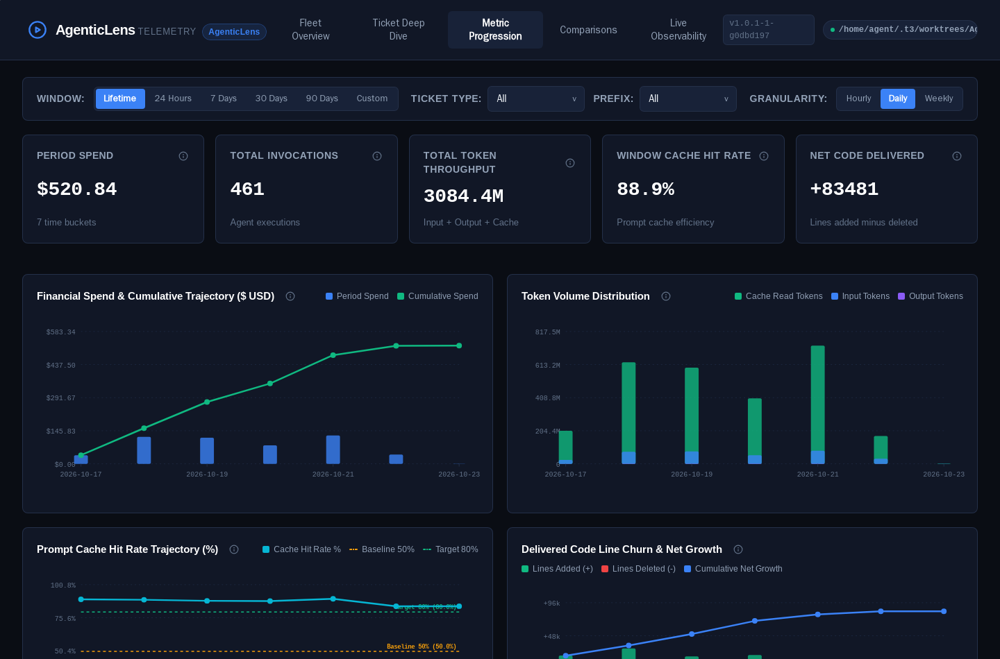
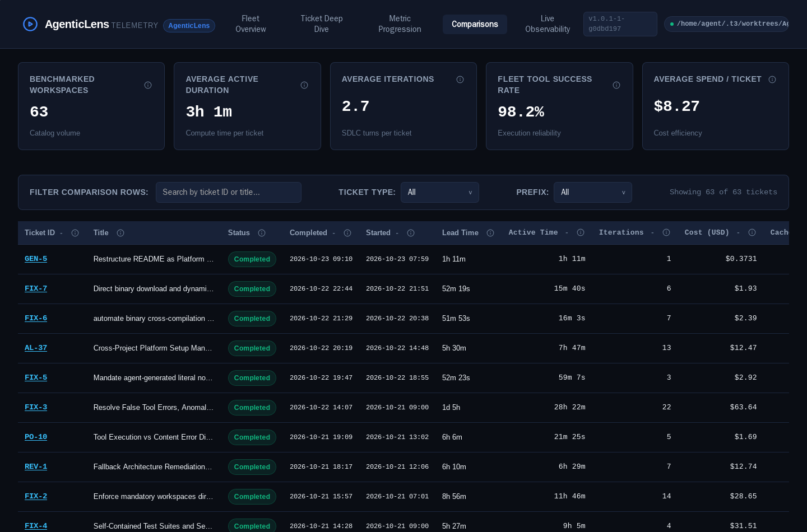

# AgenticLens

> Full-Lifecycle Telemetry, Real-Time Observability, and Anomaly Detection for Autonomous Agentic Software Engineering.

AgenticLens is a specialized observability and engineering intelligence platform built for multi-agent software development workflows. Operating directly against OpenCode execution traces, AgenticLens transforms autonomous coding agents from unpredictable black boxes into observable, accountable, and high-velocity engineering swarms.

---

## Why AgenticLens?

Autonomous AI coding agents are transforming software engineering, but unmonitored agentic execution introduces critical failure modes:

- **Runaway Token Costs**: Autonomous agents can burn through hundreds of dollars in API credits within minutes if left unmonitored.
- **Context Window Saturation**: As conversational context expands, model reasoning decays, introducing subtle bugs and hallucinations.
- **Tool Execution Death Spirals**: Agents repeatedly retry broken bash commands or file operations instead of self-correcting.
- **Subagent Rework Loops**: Hierarchical agents (e.g. planner, coder, tester) bounce incomplete tasks back and forth in endless thrashing cycles.
- **Zero Engineering Visibility**: Traditional CI/CD and APM tools capture build status, but cannot measure agent reasoning effort, turn velocity, test-to-prod code ratios, or prompt cache efficiency.

AgenticLens solves this by providing real-time telemetry streaming, deterministic execution anomaly detection, and longitudinal cost ledgers inside a single, zero-dependency executable.

---

## Core Capabilities

### 1. Real-Time Execution Observability
- Stream live agent turns, active tool invocations, and token growth directly from OpenCode's local SQLite database.
- Monitor active multi-agent sessions with sub-second latency via built-in Server-Sent Events (SSE).
- Track subagent delegation transitions (Orchestrator -> Planner -> Coder -> Tester -> Reviewer) live.

### 2. Deterministic Anomaly Detection
An embedded pure-functional configurable rule engine flags dangerous execution patterns before budgets and contexts collapse:

- **Tool Retry Streaks (`TOOL_RETRY_STREAK`)**: Identifies repeated consecutive failures on the same tool (e.g. warning at 3 failures, critical alert at 5).
- **Elevated Tool Error Rates (`TOOL_HIGH_FAILURE_RATE`)**: Surfaces unreliable tools with failure rates (e.g. exceeding 20% to 50%).
- **Context Saturation Spikes (`CONTEXT_SATURATION_SPIKE`)**: Detects hazardous token deltas (>40k/turn) and context window exhaustion (e.g. >80% of model ceiling).
- **Subagent Thrashing Loops (`SUBAGENT_REWORK_LOOP`)**: Uncovers recursive handoff ping-pong between subagent roles.

### 3. Multi-Agent SDLC Analytics
- **Role Effort Distribution**: Break down token consumption, wall-clock time, and cost across specialized agent personas.
- **Model Economics & Cache Efficiency**: Track prompt cache hit ratios, input/output token balance, reasoning token share, and exact USD costs.
- **Code Velocity & Test Ratio**: Quantify test lines versus production lines delivered per session (`Test:Prod Ratio`), files touched, and iteration cycles.
- **Tool Health & Self-Correction**: Measure invocation counts, self-correction frequency, and tool success percentages.

### 4. Automated Session Ledgers
- Automatically compile audit-ready markdown telemetry blocks into session summaries (e.g. `SUMMARY.md`).
- Ensure every work session includes verifiable proof of agent reasoning, context health, anomaly status, and test coverage.

### 5. Universal Backfill and Schema Migrations
- Recompute historical workspace facts from git commit history and SQLite event traces.
- Multi-version schema migration engine with strict seven-point mathematical invariant verification.

### 6. Single Self-Contained Binary
- Written in Go with an embedded modern TypeScript/React web dashboard.
- Zero external runtime dependencies: no Node.js, no Docker, and no external database required in production.

---

## Visual Platform Showcase

The following captures demonstrate AgenticLens operating against real multi-agent engineering traces from 63 completed software development workspaces in this repository:

### 1. Fleet Overview & Anomaly Reliability Profile
Macro-level operational telemetry aggregating $520+ in model inference, 3.08B tokens, prompt cache efficiency, active anomaly rule distributions, and brittle tool rankings:



### 2. Ticket Forensic Autopsy & Context Saturation
Granular single-ticket autopsy (AL-4) measuring turnaround lead time versus active compute duration, test-to-production ratio, reasoning token volume, and context window saturation:



### 3. Chronological Multi-Agent Trace Waterfall
Interactive execution waterfall tracking turn-by-turn transitions between Orchestrator, Planner, Coder, and Tester roles, with sub-second execution timings and failure markers:



### 4. Deterministic Anomaly Inspector
Contextual diagnostic drawer isolating tool execution failures, parameter payloads, subagent context, and error diagnostics:



### 5. Longitudinal Metric Progression
Temporal velocity tracking cumulative financial spend trajectories, token volume distributions, prompt cache hit rate baselines, and net code churn:



### 6. Cross-Ticket Benchmarking
Comparative matrix ranking tickets by active duration, turnaround lead time, iteration cycles, and cost:



---

## Powering the Agentic SDLC

AgenticLens brings rigor to the Autonomous Software Development Life Cycle:

```
+-----------------------------------------------------------------------------------+
|                           Autonomous Multi-Agent SDLC                             |
+-----------------------------------------------------------------------------------+
|                                                                                   |
|  [ Inception / PO ] ----> [ Plan ] ----> [ Code ] ----> [ Test ] ----> [ Review ] |
|         |                     |              |             |               |      |
|         v                     v              v             v               v      |
|  +-----------------------------------------------------------------------------+  |
|  |                           AgenticLens Telemetry Bus                         |  |
|  |  * Real-Time SQLite Polling                 * Anomaly Guardrails            |  |
|  |  * Role Effort Tracking                     * Token & Dollar Ledger         |  |
|  |  * Context Window Saturation Warning        * Test-to-Prod Code Facts       |  |
|  +-----------------------------------------------------------------------------+  |
|                                       |                                           |
|                                       v                                           |
|                   +---------------------------------------+                       |
|                   |  Observable Dashboard & Artifacts     |                       |
|                   |  - Embedded Web SPA (port 8085)       |                       |
|                   |  - Markdown SUMMARY.md Telemetry      |                       |
|                   |  - Automated Work Session Audit Trail |                       |
|                   +---------------------------------------+                       |
+-----------------------------------------------------------------------------------+
```

1. **Pre-flight & Inception**: Track architectural planning and contract formulation without runaway prompt spending.
2. **Implementation Guardrails**: Catch tool failure spirals and context saturation spikes before code corruption happens.
3. **Adversarial Verification**: Monitor testing velocity and ensure test-to-production ratios satisfy engineering standards.
4. **Handoff & Merge**: Stamp every work session with deterministic execution telemetry, anomaly verdicts, and cost ledgers.

---

## Quick Start

### Download Precompiled Binary

Download the latest standalone binary for your operating system from GitHub Releases:

```bash
# Example for Linux x86_64:
curl -fsSL https://github.com/NiltonDuarte/AgenticLens/releases/latest/download/agentic-lens-linux-amd64.tar.gz | tar -xz

# Run the dashboard:
./agentic-lens server --port 8085
```

Open `http://localhost:8085` in your browser.

Precompiled binaries are available for:
- Linux (`x86_64`, `arm64`)
- macOS (`Intel`, `Apple Silicon`)
- Windows (`x86_64`)

---

## CLI Overview

AgenticLens provides a unified CLI for automation and local workflows:

```bash
# Start the web server and dashboard (default port: 8085)
./bin/agentic-lens server --port 8085

# Ingest active session telemetry and generate summary markdown block
./bin/agentic-lens generate --ticket-id AL-15 --ticket-type feat --json-output alspaces/AL-15/agentic_metrics.json --append alspaces/AL-15/SUMMARY.md

# List all tracked workspaces with detected anomaly counts
./bin/agentic-lens --list

# Inspect detailed anomaly diagnostics for a specific ticket
./bin/agentic-lens --ticket-id AL-15 --anomalies

# Batch reconcile git facts and database telemetry across historical workspaces
./bin/agentic-lens backfill --recompute-git --recompute-db --migrate-schema --update-summaries

# Run stepwise schema migrations across workspace ledgers
./bin/agentic-lens migrate --backup --update-summaries
```

---

## Deep Dive Documentation

- **[ARCHITECTURE.md](ARCHITECTURE.md)**: Comprehensive deep dive into the Functional Core, Imperative Shell (FCIS) pattern, domain models, adapter layers, anomaly rule engine, and schema migration mechanics.
- **[CONTRIBUTING.md](CONTRIBUTING.md)**: Developer setup, local development with hot reload, testing guidelines, complete Makefile target reference, and release packaging.
- **[TECHNICAL_GUIDELINES.md](TECHNICAL_GUIDELINES.md)**: Coding standards, typing rules (zero `any`), data race prevention, and invariant enforcement.
- **[docs/SETUP_MANUAL.md](docs/SETUP_MANUAL.md)**: Complete guide for integrating AgenticLens into target repositories via autonomous agent skills or direct binary deployment.

---

## License

This project is licensed under the MIT License. See [LICENSE](LICENSE) for details.
