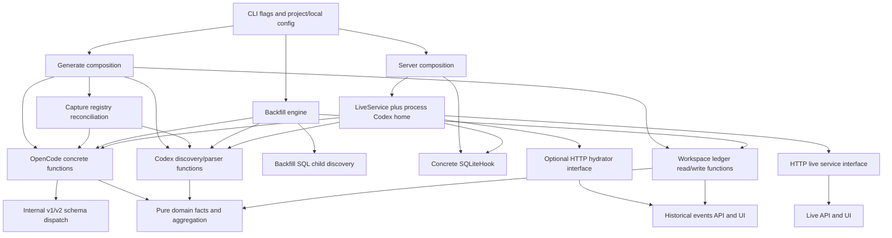
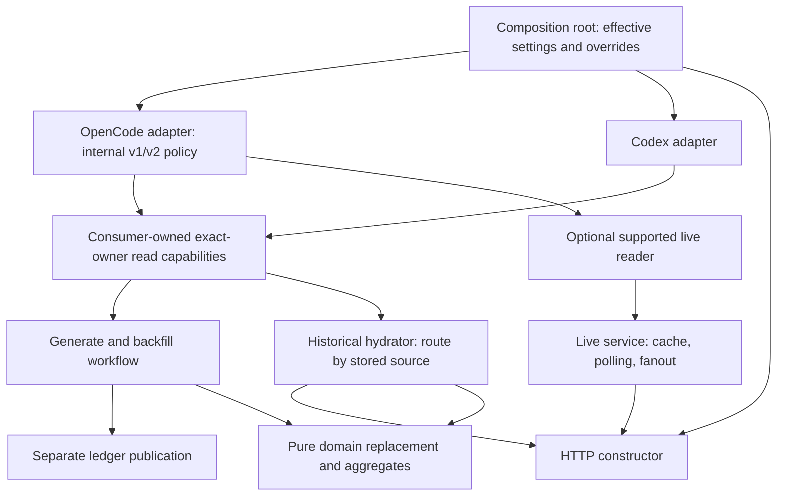

# AL-67 telemetry repository contracts and dependency injection

## Assessment boundary

Reviewed application revision: `a84adbe5be46c2ef52ede0987a417562715d38e1`. This is a documentation assessment of OpenCode v1, OpenCode v2 and Codex source access. No application, schema, runtime or test changes implement the proposed design. The [contract](CONTRACT.md) and [plan](iterations/01/PLAN.md) were explicitly approved for this scope.

There is no common native telemetry-source repository interface today. OpenCode v1/v2 share dispatch inside one adapter; Codex supplies free discovery/parser functions. Consumers receive normalized domain values, but generate, backfill and historical hydration still compose concrete source operations differently. HTTP has useful consumer-owned service interfaces. A meaningful improvement is to share exact-owner read capabilities and centralize effective source settings, while keeping live observation, discovery policy and workspace-ledger persistence separate.

This assessment establishes source wiring and bounded fixture behavior. It does not certify installed harness versions, real-source availability, race freedom or performance. Code references below are relative to this document and describe the reviewed revision. Findings are pre-existing debt or recommendations, never shipped fixes. Review attribution, adjudication and verification are retained in [SUMMARY.md](SUMMARY.md) and [compact findings](iterations/01/REVIEW_SUMMARY.json).

## Current contracts and ownership

| Boundary | Actual contract, construction and callers | Responsibility and limit |
| --- | --- | --- |
| Workspace-ledger repository | [repository.go](../../backend/internal/adapters/repository.go): `ResolveWorkspacesDir`, `ScanWorkspaces`, `LoadTicketWorkspace`, `LoadOwnedFactLedger`, `SaveFactLedgerPreservingHistory`, `SaveMetricsLedger` | Filesystem loading, validation, read projection and publication of shared history. It is not a source-session repository. |
| OpenCode native access | [client.go](../../backend/internal/adapters/opencode/client.go): `OpenDB` returns concrete `*OpenCodeDB`, exposing `*sql.DB` through `DB`; resolver/extractor free functions consume that handle | Both schema families normalize into domain facts/events. There is no public native-source port or interface conformance assertion shared with Codex. |
| Codex native access | [discovery.go](../../backend/internal/adapters/codex/discovery.go): `DiscoverRolloutPaths`, `DiscoverExactRolloutPath`, `ParseRolloutPath`; [rollout.go](../../backend/internal/adapters/codex/rollout.go): `ParseRollout`, `CombineTranscripts`, `Transcript.SessionFacts` | File discovery, exact identity, native parent evidence and normalization. Files/gzip readers close inside the adapter; no long-lived Codex connection is injected. |
| Backfill workflow | [engine.go](../../backend/internal/adapters/backfill/engine.go): `NewEngine` initializes three private Codex function fields; `Execute` constructs OpenCode access itself; [recovery.go](../../backend/internal/adapters/backfill/recovery.go) also queries SQL | Owns migration/recovery/preservation/publication policy. Codex function seams are internal initialization, not an external common repository injection constructor. |
| Historical hydration | [handlers.go](../../backend/internal/adapters/http/handlers.go), `WorkspaceEventHydrator` at line 249: `HydrateWorkspaceEvents`; implemented by [LiveService](../../backend/internal/adapters/live/service.go) | A real consumer-owned interface. Per-recorded-owner source routing produces transient events/coverage, independent of ledger writes. Concrete source selection remains inside the service. |
| HTTP live service | [live_handlers.go](../../backend/internal/adapters/http/live_handlers.go), `LiveServiceInterface` at line 17: tree, trace and subscription; [server.go](../../backend/internal/adapters/http/server.go), `NewServerWithConfig` | Receives the service interface, then type-asserts optional hydration from the same object. A separate hydrator cannot currently be supplied independently. `Subscribe` exposes the live package's event type. |
| Live source access | [service.go](../../backend/internal/adapters/live/service.go), `NewLiveService` / `NewLiveServiceWithCodexHome`; [sqlite.go](../../backend/internal/adapters/live/sqlite.go), `OpenReadOnlyHook` | Service owns a concrete hook, cache, polling and subscribers. Hook owns read-only SQL pool/revision observer. Current active tree/trace queries use v1 tables. |
| Domain and presentation | [models.go](../../backend/internal/domain/models.go), [trace.go](../../backend/internal/domain/trace.go), [events.go](../../backend/internal/domain/events.go); [client.ts](../../web/src/api/client.ts), [validation.ts](../../web/src/api/validation.ts), [liveApi.ts](../../web/src/api/liveApi.ts) | Pure values/aggregation and explicit historical coverage states. UI consumes HTTP contracts and does not select SQLite schemas or native stores. No source I/O belongs in domain. |

### Implemented dependency map

The capture registry is writable machine-local operational state. It is neither a replacement for native source authority nor an authenticity requirement on portable Git-shared ledgers. Its registered-only branch can collect owners from multiple harnesses. One configured generation source is not a universal filter on all capture reconciliation results.

## Operation and result matrix

| Operation | OpenCode v1 | OpenCode v2 | Codex | Contract implication |
| --- | --- | --- | --- | --- |
| Harness selection | `opencode` | `opencode` | `codex` | v1/v2 are schema families, not separate harness flag values. |
| Ordinary root/session discovery | Nonce, explicit ID, then supported ticket/path heuristics in v1 resolver | Family dispatcher calls v2 resolver with its own SQL | Nonce or exact ID required; root/descendants from metadata; conflicting nonce/root selection errors | Keep selector semantics explicit; do not add unused selector fields to every consumer. |
| Exact owner lookup | Family membership in `session` | Membership in `session_v2` | Exact discovery rejects multiple candidate paths; family discovery has weaker ambiguity handling | Exact reads are a useful shared capability; exact file/owner ambiguity must remain an error or incomplete result. |
| Facts and source events | Strict message/part decoding | Strict typed `session_message` decoding | Warning-aware JSONL/gzip parsing and transcript normalization | Return identity and completion with values; only successful complete owner snapshots authorize replacement. |
| Children | Generic extraction includes selected IDs and direct children; capture exact mode excludes children | Same scope, different storage schema | Family discovery traverses metadata-backed descendants; combine resolves native child references | Ordinary extraction is not recursive full-tree discovery. Backfill recursion and bounded capture paging are separate operations. |
| Historical trace/events | Exact source-event extractor | Exact source-event extractor | Per-owner transcript events | All three support historical evidence, with explicit partial/unavailable diagnostics. |
| Refresh/recovery | Backfill discovers descendants, reads exact snapshots and retains failures | Same exact reader; tree discovery has a mixed-layout selection limitation | Backfill groups accepted owner transcripts, retaining unavailable/partial owners | Recovery/preservation is workflow policy, not native CRUD. Heuristic recovery stays explicit opt-in. |
| Active tree/live trace/SSE | Implemented by v1-shaped SQLite hook/service | No v2 live reader in this path | No Codex live observer in this path | Offline/historical support does not imply live parity. Unsupported capability must be reported truthfully. |
| Snapshot and ordering | Exact capture uses dedicated read transaction; ordinary v1 rows order by timestamp | Exact capture uses same transaction mechanism; messages order by sequence/time/ID | File parse and discovery are separate reads; event merge is stable by timestamp | Completion is not a promise of one globally simultaneous tree snapshot or identical tie ordering. |

Evidence owners: [resolver.go](../../backend/internal/adapters/opencode/resolver.go), [schema detection](../../backend/internal/adapters/opencode/schema_family_detection.go), [extractor.go](../../backend/internal/adapters/opencode/extractor.go), [exact snapshots](../../backend/internal/adapters/opencode/capture_snapshot.go), [v1 extraction](../../backend/internal/adapters/opencode/schema_v1_session_extraction.go), [v2 extraction](../../backend/internal/adapters/opencode/schema_v2_session_extraction.go), [Codex discovery](../../backend/internal/adapters/codex/discovery.go), [source occurrences](../../backend/internal/adapters/codex/source_occurrences.go), and [backfill recovery](../../backend/internal/adapters/backfill/recovery.go).

Generic OpenCode detection rejects unknown, partial and mixed known layouts. Exact capture/hydration has a different legitimate policy: a mixed store can be read when one complete family uniquely owns the requested ID; membership in both families is ambiguous and rejected. Backfill tree discovery instead prefers `session_v2` whenever that table exists. Do not describe all three paths as one uniform mixed-schema policy.

Identity is per recorded harness/session owner, with source-proven parents. The current ledger also requires globally unique session IDs; conflicting same-ID harness owners are rejected rather than overwritten. Genuine repeated invocation/skill/delegation occurrences are preserved. An unavailable owner must not become a zero or be removed merely because another owner refreshed successfully.

## Effective configuration and composition

[config.Load](../../backend/internal/adapters/config/loader.go) discovers the owning shared configuration upward within its Git boundary and overlays selected local fields. Machine-specific `telemetry.default_source` and `telemetry.sources` are handled by the local overlay; they are not generally merged from shared YAML like legacy `database.path`. [source.go](../../backend/internal/adapters/config/source.go) defines the selector/path helpers. Loading a value and injecting that value into a consumer are separate guarantees.

| Consumer | Harness and path selection actually implemented | Injection/output |
| --- | --- | --- |
| Generate | Explicit `--source` > local default > OpenCode. OpenCode: CLI DB > project-anchored local DB > project-anchored legacy DB > adapter default. Codex: CLI home > project-anchored local home > environment > built-in home | Concrete adapter functions in `runGenerate`; normalized facts/events then owner replacement, aggregate calculation and publication. Selected-source errors abort rather than probe the other harness. |
| Registered generation/capture | Registry binding identifies each harness/store/exact native owner; manual selection can additionally contribute | [capture.go](../../backend/cmd/agentic-lens/capture.go) / [reconcile.go](../../backend/internal/adapters/capture/reconcile.go) validate registration identity and snapshots. This intentionally differs from one-source manual discovery. |
| Backfill CLI | Explicit source required: `opencode`, `codex`, `both`/`all`; local default does not supply it. DB/home flags precede loaded settings, then environment/adapter defaults as applicable | `NewEngine().Execute(options)` constructs concrete OpenCode and internal Codex dependencies; partitions stored owners before refresh. CLI configuration from cwd and engine configuration from target workspace are separate resolution points. |
| Server/live | No source or Codex-home flag. DB flag > local OpenCode path > legacy DB > adapter default; only home expansion, no project-relative anchoring | Opens hook if DB is present, constructs service and starts polling. Codex home is taken from environment/builtin by constructor, ignoring loaded local Codex home. |
| Historical hydration | Stored owner `Source` and exact `ID` determine native operation; no first-available-harness fallback | OpenCode uses hook DB with exact family dispatch; Codex uses service home and exact owner filtering. Unknown owners get diagnostics. Partial successes retain usable owners. |

Built-source generate/backfill/server help was checked. Source-selection helpers do not prove that every command uses them. Explicit CLI relative paths intentionally retain caller-relative semantics; configured relative paths belong to the project. Sources from another targeted project must not be silently combined with cwd configuration in a future resolver.

### Concrete request walkthroughs

These are source-level requests, not claims that example stores or sessions exist on this machine. The wrapper-level `--al-project` is placed before the native command; ordinary examples use an exact selector. A directly built native runs from the selected project directory instead of accepting wrapper-only flags.

1. OpenCode v1: `agentic-lens --al-project /repo generate --source opencode --db-path /sources/v1.db --session-id ses-root --ticket-id EXAMPLE-1 --ticket-type docs`. [runGenerate](../../backend/cmd/agentic-lens/main.go) resolves harness at line 214, opens the selected DB at line 422, resolves root through family detection, then uses strict source extraction. V1 reads `session/message/part`, builds owner facts/events and enters common replacement/aggregation/publication. The resulting JSON/summary use normalized facts. Historical events GET loads the persisted ledger and exact v1 events; v1 live endpoints separately use SQLiteHook. Source read failure does not select Codex.
2. OpenCode v2: same command with `/sources/v2.db` and its exact root. Family validation selects `session_v2/session_message`, then the v2 resolver/strict extractor supplies the same domain boundary, preserving native message sequence. Backfill with explicit OpenCode source refreshes discovered exact owners through capture snapshots. Historical events GET can hydrate v2 via exact family dispatch. The same server hook does not provide v2 active-tree/trace queries: see F03. An unrelated v1 runtime version is not inferred from schema shape.
3. Codex: `agentic-lens --al-project /repo generate --source codex --codex-home /sources/codex --session-id thread-root --ticket-id EXAMPLE-1 --ticket-type docs`. Generate selects home at line 361, discovers root and source-proven descendants, parses each rollout, rejects warning-bearing incomplete generation, combines and normalizes owner facts, then enters common publication. Backfill with explicit Codex source retains unrelated OpenCode owners. Historical events GET routes Codex owners using stored identity and the service's home. Setting `CODEX_HOME` to that source enables the current server path; setting only local configured home exposes F01. No Codex live tree/trace implementation follows from this historical support.

[HTTP handlers](../../backend/internal/adapters/http/handlers.go) load persisted detail before optional events, seed fallback anomalies and return unavailable coverage on enrichment failure. [TicketDeepDive](../../web/src/views/TicketDeepDive.tsx) shows detail before fetching optional events; [events projection](../../web/src/domain/events.ts) keeps recorded summaries for incomplete owners. Event decoding validates coverage and ownership. Live API/UI uses different endpoints and selection guards in [useLiveTrace](../../web/src/hooks/useLiveTrace.ts); it does not choose native repositories.

## Findings and prioritized follow-ups

Scores are impact estimates from 0 to 10, not evidence of production incidents. Every item remains unimplemented. Follow-up ownership below means the proposed responsibility, not a newly created ticket or dependency.

| ID / severity | Finding, reachable effect and counterevidence | Bounded recommendation and verification |
| --- | --- | --- |
| F01 / 6 | Server ignores local Codex home: `main.go:789,800` calls `NewLiveService`, whose `service.go:65–73` consults only environment/home. A valid configured store can hydrate during generation yet be unavailable in server events. Explicit-home constructor tests bypass production wiring. Persisted facts survive. | CLI composition owner: resolve and inject home explicitly; test conflicting local/environment stores through production wiring, exact identity, mixed owners and unchanged ledger bytes. |
| F02 / 5 | Generate anchors configured relative paths; server/backfill only expand home (`main.go:361,422` versus `774–787,914–926`). Nested cwd can select a missing or competing store. Absolute paths and root-cwd calls mask it. | Composition owner: share effective project settings without changing explicit CLI-relative semantics or symlink traversal. Test nested cwd, local overrides, both harnesses and target-project ownership. |
| F03 / 5 | Live hook opens/advertises v2 DB but active/trace queries require v1 tables (`live/sqlite.go:182–449`); polling drops errors (`service.go:158–162`), SSE suppresses initial tree failure. REST reports errors. Historical v2 hydration works separately. | Live composition owner: expose unsupported observer capability before activation; preserve historical hydration. V2 live implementation requires separate product scope. Verify valid v1, v2-only, partial/mixed schemas and API/SSE diagnostics. |
| F04 / 6 | Codex family discovery returns duplicate files for one native owner, including active/archive copies. `CombineTranscripts` appends snapshots; `domain.SessionsFromFacts` groups one owner while appending rows/summing tools. This can inflate cumulative facts; hydration picks the first accepted copy. Exact discovery already rejects duplicates. | Codex adapter owner: reject/report ambiguous owner snapshots before combination; preserve prior facts and legitimate repeated rows within one transcript. Verify identical/divergent copies across generate, backfill and hydration. No real duplicate-store incident was observed. |
| F05 / 4 | Live trace swallows child lookup error (`service.go:454–463`) and returns no partial diagnostic. Existing test deliberately drops `parent_id` while retaining readable messages. Withholding an unproven link is correct; inability to distinguish unavailable lookup from proven absence violates the checklist. | Live DTO/service owner: preserve usable trace and add relationship availability/diagnostic; revise the existing oracle. Do not fabricate child IDs or fail all trace content. Historical hydration coverage is a separate contract. |
| F06 / 4 | Caller contexts stop above expensive SQL/file reads. Live hook uses non-context queries; hydration scans/parses without context; backfill passes Background into exact snapshots despite its workspace timeout. Revision reads and preflight have some context support. No latency/race incident measured. | Source adapter owner: carry context into actual query/read loops, preserve partial state and transaction cleanup; test cancellation during read and original-ledger preservation. Keep I/O/cancellation in shell. |
| F07 / 3 | Storage knowledge leaks into backfill SQL and hydration via `hook.DB()`. Mixed-store backfill chooses v2 table even when an exact v1 owner could hydrate; old facts are preserved with diagnostics. This is distinct from general generate's intentional mixed rejection. | Adapter/backfill owners: move exact-owner/children operations behind narrow consumer ports. Preserve per-operation schema policy; any expansion of mixed-store recovery is an explicitly approved compatibility change. |
| F08 / 3 | Shared snapshot guarantee is unspecified: exact SQLite capture is transactional, ordinary extraction/hydration spans multiple queries, Codex discovery/parse are separate file reads. A changed revision prevents caching but the read can still be returned. Torn read is a hypothesis, not observed corruption. | Native read contract owner: document per-owner completion versus observation boundary; verify concurrent writer behavior before strengthening guarantees. Do not force global tree atomicity on file sources. |
| F09 / 2 | V1 timestamp-only ordering has weaker tie semantics than v2 sequence/time/ID; Codex preserves file/stable merge ordering. No demonstrated wrong anomaly. | Adapter contract owner: define deterministic ties/native sequence precedence where needed, preserving equal-valued repeated occurrences. |
| F10 / 3 | Required-column omission test builds both schema families for every case and always expects mixed rejection. Removing column checks could leave it green because the mixed guard runs independently. Production column validation still exists. | Test owner in approved follow-up: isolate each family and assert intended guard, while retaining mixed-schema cases. Current green tests do not establish independent per-column rejection. |
| F11 / 2 | Generate no-fallback test names alternate stores but creates neither. It proves selected error/path and no output, not refusal of an available matching alternate. Other CLI tests do exercise successful local Codex extraction. | CLI test owner: add a usable competing fixture in future authorized work; retain existing publication/error assertions. No automatic cross-harness fallback was found in code. |
| F12 / 1 | A universal repository combining ledger CRUD, native extraction and live observation would erase capability/lifetime differences. This is a design caution, not an observed product defect. | Architecture owner: use the split target below; no factory-only forwarding wrappers or speculative methods. |

Precise source anchors for F04: [discovery.go](../../backend/internal/adapters/codex/discovery.go) lines 98–120,155–190,319–343; [rollout.go](../../backend/internal/adapters/codex/rollout.go) lines 922–1005; [models.go](../../backend/internal/domain/models.go) lines 231–305. Parent adjudication rejects the data follow-up's tentative duplicate-validation defense: grouping happens before ledger validation and yields one owner with appended rows, so session-ID uniqueness cannot detect duplicate cumulative snapshots. Missing an explicit policy to merge duplicate files does not justify counting them as distinct invocations. This confirms the first data review's source-level counterexample, without claiming a runtime reproduction.

F05 had different reviewer interpretations. Architecture review correctly emphasized optional link enrichment and useful trace retention; data/test reviewers identified the missing failure representation. The canonical checklist requires error or explicit partial state for failed child lookup. Both useful-content preservation and truthful availability are required; the existing test cannot supersede that rule. This is accepted follow-up debt in a documentation delivery, not a code fix.

F10 is a test-oracle limitation, not evidence that current schema validation is broken. Test-effectiveness reviewers also identified meaningful positive fixture evidence; those strengths must not be erased by the gaps.

## Resource and operational semantics

`OpenDB` uses read-only file SQLite and callers defer close. Live hook uses read-only mode plus query-only pragmas, a 5-open/2-idle pool and configured busy timeout. It does not imply every configured timeout/read-only field controls every native reader. The capture registry and workspace publication remain writable responsibilities. File/gzip readers close at native boundaries.

Exact OpenCode capture sets a dedicated handle to one connection and uses BEGIN/ROLLBACK around membership, budget checks and extraction. A future shared concurrent source adapter must preserve that dedicated-handle assumption or use correctly owned connections/transactions; it cannot reuse live's pool indiscriminately. Completion pertains to known accepted owners, not proof that no unknown child exists elsewhere.

Live service owns one ticker per production Start, bounded subscriber channels and nonblocking broadcasts that can drop events for slow subscribers. Subscription cleanup is protected by the same lock used for broadcast. Trace cache uses a retained SQLite data-version connection plus connection epoch, resets on changed revision and reuses unchanged snapshots. Cache keys are discovered owners plus a selected off-tree lookup. It does not unconditionally rebuild every history on unchanged ticks. Any DB revision invalidates all snapshots; Codex historical hydration scans store per owner. These are workload considerations, not measured performance findings.

`Close` is once-protected, stops polling and closes the hook, but does not join in-flight polling or close subscriber channels. Server closes the service then shuts HTTP down with a five-second deadline. Normal production calls Start/unsubscribe once; unsupported repeated lifecycle calls are not separate demonstrated defects. Future ownership contracts should cover cancellation, active readers and cleanup explicitly, including F06.

## Proposed target arrangement — not implemented

- Exact owner facts capability: context, exact identity and a result binding source/ID/parent, facts and completion. Complete-empty, partial, unavailable, unsupported and operational errors must be distinguishable. Only complete accepted facts replace stored owner snapshots; unavailable history survives.
- Smaller historical-event capability: exact owner events plus coverage; consumers need not calculate all financial facts or own polling. The same native adapter can satisfy both capabilities using shared private decoders.
- Separate discovery/children capabilities: retain actual nonce/root/heuristic semantics and capture's bounded paging requirements. Do not require unused fields or pretend Codex supports SQL pagination. Native parent evidence remains necessary.
- Separate live reader/observer: only implementations with truthful active-tree/trace/revision support participate. Service owns polling/subscription/cache; no live method is required of Codex or current v2 offline adapters.
- Composition roots own source-instance lifetime and resolve config once. Mixed ledgers use a harness-to-capability registry per stored owner, never whichever source opens first. OpenCode schema dispatch stays within that adapter. HTTP receives live and historical services independently rather than discovering one by type assertion.
- Ledger loading/publication stays independent. Put consumer interfaces in imperative workflow/service packages and share pure domain values inward; do not add SQL, clocks, context-driven I/O or Close to functional domain calculations.

Recommended sequence: first correct configuration injection and project-relative paths (F01/F02); then expose live capability truthfully (F03) and child lookup availability (F05); settle duplicate-owner snapshots (F04); then introduce small exact-owner/event seams and move native child SQL (F07), preserving existing behavior. Propagate cancellation and specify snapshots/order/lifetime (F06/F08/F09) with measured needs. Strengthen the coherent existing tests (F10/F11 and composition gaps) as part of those separately approved slices. Each stage must preserve source labels, exact IDs/parents, legitimate multiplicity, complete-empty replacement, missing-owner retention, mixed harnesses, partial diagnostics, baseline visibility and no GET writes. No new ticket or blocking dependency is created here.

## Verification and remaining limits

At the reviewed revision, canonical `make web-assets` passed after dependency installation. A host binary built from source and its generate/backfill/server help were inspected. Existing checks ran from `backend/`:

- `go test -race ./internal/adapters/config ./internal/adapters/opencode ./internal/adapters/codex ./internal/adapters/backfill ./internal/adapters/live ./internal/adapters/http ./cmd/agentic-lens -run 'Test(ResolveTelemetrySources|SchemaFamily|GenerateSelectedSourceDoesNotFallback|BackfillEngine_(Source|MultiMachine)|Hydrat|LiveTraceSurvivesChildSessionLookupFailure|LeanFactsSurviveSourceTraceAvailabilityWithoutGETWrites|WorkspaceEvents_EndToEndLiveServiceHydrationAndPathTraversal)' -count=1` passed. Codex matched no tests in that filter and is not counted as executed coverage there.
- `go test -race ./internal/adapters/codex -count=1` passed separately.

Existing evidence includes real SQLite/JSONL fixtures for v1/v2 extraction and Codex ownership; backfill source partition, multi-machine lifecycle and missing-owner preservation; mixed native hydration and ledger-byte preservation; HTTP persisted fallback/error/complete-empty/partial projections; CLI selected-source error/no-publication. Some inspected tests fell outside the focused filter and are inspection evidence until the integrated full suite. Resolver tests and explicit-home constructors do not prove every production composition. HTTP mock hydrators appropriately test response policy but do not prove native configuration injection.

The integrated `make` result, exact reviewed delivery revision, eight focus/model outcomes and telemetry completeness are recorded in SUMMARY.md at delivery. Real producer sessions were not created for compatibility testing, no duplicate-file/cancellation mutation probe ran, and browser, release and hosted-CI execution are not claimed by these fixture checks. AL-55 and AL-62 summaries were historical leads only; no other ticket artifacts or ledgers were modified. AL-63 capability parity, AL-64 duration and AL-66 toggles retain their separate scope and no current runtime proof is borrowed from their specifications.
